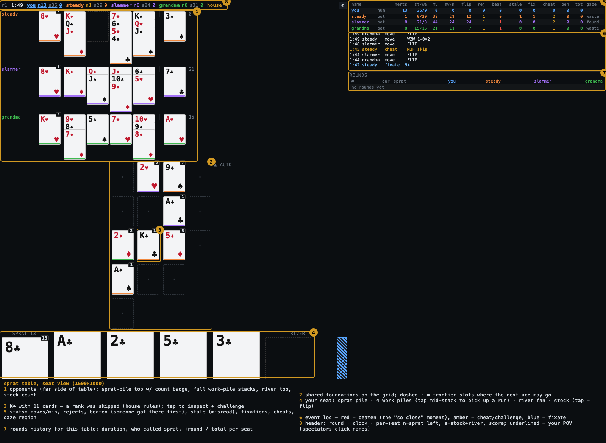
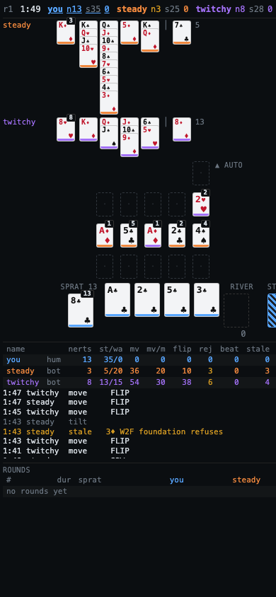
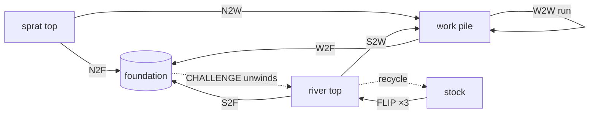
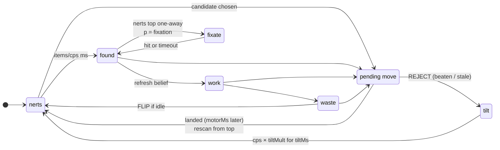
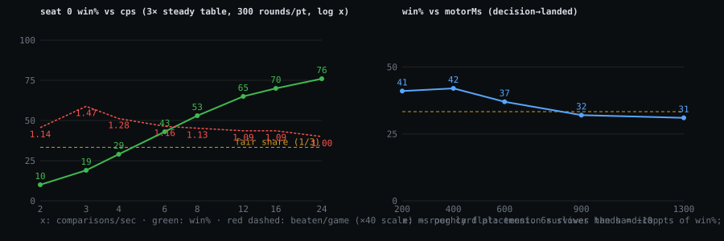
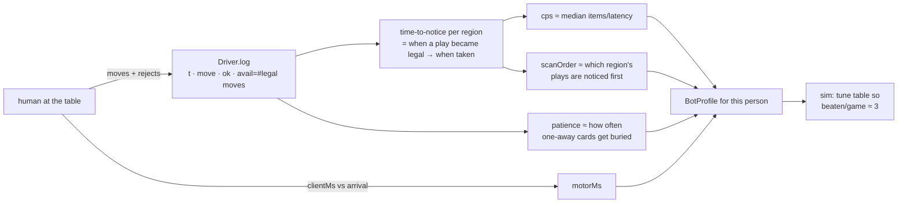

# sprat — design

Sprat (≡ Nerts / Pounce / Racing Demon). Real-time multiplayer solitaire; the interesting engineering is
not the rules but **modelling human attention** so bots lose contested plays the way people do.

Contents: [stack](#stack) · [the table](#the-table) · [rules](#rules) · [bots](#bots--the-attention-model) ·
[geometry](#table-geometry) · [cheating](#cheating-house-rules) · [sim](#headless-sim) · [calibration](#calibration) · [roadmap](#roadmap)

---

## Stack

TypeScript everywhere, **one engine module** shared by three hosts:

```mermaid
flowchart LR
  subgraph engine["src/engine (pure, ~300 LoC)"]
    R[rules.ts<br/>legalMoves · apply · allowedCells]
    S[state.ts<br/>GameState · Move · deal]
  end
  subgraph bots["src/bots"]
    B[bot.ts<br/>attention model]
    P[profile.ts<br/>presets]
  end
  D[sim/driver.ts<br/>owns state + bots<br/>virtual or wall clock]
  engine --> D
  bots --> D
  D --> SIM[sim/cli.ts<br/>10⁴× realtime<br/>sweeps, metrics]
  D --> SRV[server/server.ts<br/>ws · rooms · redaction]
  D --> WEB[web/main.ts<br/>LocalSession<br/>you vs bots, offline]
  SRV <-->|JSON ≅ sprat.proto| WEB2[web/main.ts<br/>RemoteSession<br/>phones, spectators]
  style engine fill:#161b22,stroke:#3fb950
  style D fill:#161b22,stroke:#58a6ff
```



Rejected: a FastAPI/misk backend. It would force a second rules implementation, and rules drift between
client-side prediction and server validation is the one bug class that would make the game feel wrong.
`proto/sprat.proto` is the schema of record; v1 wire is JSON with identical field names (`buf generate`
→ protobuf-es is a roadmap item, needed once a non-TS client exists).

`Driver` is the only thing that knows about time. `runVirtual()` pops a priority queue of bot wake-ups;
`startReal()` uses `setTimeout` against `performance.now()`. Same bot code either way, so a preset that
produces 3 "beaten" events per round in the sim does so at the table.

---

## The table



Seat view: opponents on the far side, shared foundations in the middle, your piles nearest you.
Everything is **tap-select → tap-target** (no drag), so phones and desktops use the same code path.
Spectators get the full state and click names in the header to swap POV.

Phone (390 px) uses the same layout at smaller card sizes:



---

## Rules

Per [Bicycle](https://bicyclecards.com/how-to-play/nerts). Each player has their own deck (own back colour):

```
 per player                                   shared
 ┌──────────┐  ┌───┐┌───┐┌───┐┌───┐          foundations: A→K by suit, anyone plays
 │ sprat 13 │  │ W ││ W ││ W ││ W │          first card there wins
 │ top up   │  │ 0 ││ 1 ││ 2 ││ 3 │
 └──────────┘  └───┘└───┘└───┘└───┘          score  +1 per foundation card (by deck)
 ┌──────────┐  ┌──────┐                             −2 per sprat card left
 │ stock 35 │→ │ river│ flip 3, top playable        −penalties (challenges)
 └──────────┘  └──────┘ recycle when empty
```

Card = integer, `deck*52 + suit*13 + (rank-1)`; suits ♥♦♣♠ = 0..3. `isRed(c) = suit < 2`. Cheap to
compare, trivially serialisable, and card ids persist across rounds (the UI uses that to animate the
end-of-round "sort back to owners" for free).

Where a card can go:



| move | legal when | notes |
|---|---|---|
| `N2F/S2F/W2F f` | `f=-1`: card is an ace → new pile at `cell`; else same suit & rank = top+1 | contested: **first to arrive at the engine wins**, later arrivals rejected |
| `N2W/S2W w` | pile empty, or opposite colour & rank = top−1 | |
| `W2W from n to` | bottom of the n-card run fits `to` | any suffix of a pile is a valid run by construction |
| `FLIP` | stock or river non-empty | empty stock ⇒ recycle+flip in one motion |
| `NERTS` | sprat pile empty | ends the round |
| `ROTATE` | driver-issued on stall | everyone's stock: top → bottom; resume (family rule). Dead after 3 |

Engine is a mutating `apply(state, p, move) → {ok} | {ok:false, why}`; on reject the state is untouched.
Legality is pure and cheap (`legalMoves` ≈ 30 µs), so the sim logs *how many legal moves existed* at every
attempt — that's the calibration signal (§Calibration).

---

## Bots — the attention model

A bot is a **sequential attention budget**. It never sees the whole state; it sees whatever its gaze is on,
at a cost, and acts on what it *believes*.



### The race for the 2♥ (why "beaten" happens)

Concrete trace, two bots, ♥ foundation currently `A`. `steady` (cps 5, motor 600) holds 2♥ on a work pile;
`twitchy` (cps 11, motor 350) has 2♥ on top of its sprat pile. Three foundation piles on the table.

```
 t(ms)  steady                                     twitchy                              ♥ pile
    0   look nerts   (1 item → 200ms)              look nerts (1 item → 90ms) → 2♥!      A
   90                                              fTarget(2♥) via belief ♥=A → N2F
                                                   motor 350 …
  200   look found   (3 piles+1 → 800ms)
        belief := {♥:A, ♦:2, ♣:K}
  440                                              2♥ LANDS                               2
 1000   candidates from belief: W2F 2♥ → ♥        rescan from nerts …
        motor 600 …                                                                       2
 1600   apply W2F → REJECT "foundation refuses"
        top rank 2 ≥ my 2 ⇒ event BEATEN
        tilt: cps 5→3 for 1500ms; look found
        belief := {♥:2 …}  (my 2♥ is now dead weight)
```

steady's belief was correct at t=200 and wrong by t=440; it didn't look again until the rejection.
That 1,160 ms window — scan latency + motor time — is the whole handicap. No dice roll decides who wins
the 2♥; **arrival order at the engine does**, and arrival time is a function of where the gaze was.

### Parameters (`bots/profile.ts`)

| knob | what it models | first-order effect |
|---|---|---|
| `scanOrder` | the gaze loop: `nerts→found→work→waste` vs `nerts→waste→found→work` (river rat) | which plays get noticed first |
| `cps` | comparisons/sec. Region cost = `items/cps` (`found` = Σ(1+reach·dist)+1, `work` = 2·piles) | **the** handicap knob (chart below) |
| `motorMs`, `flipMs` | decision → landed | size of the window in which you can be beaten |
| `psychic` ∈[0,1] | prob. belief is refreshed free at decision time; 1 = omniscient | surprisingly small (chart) |
| `confusion`, `colorblind`, `eyestrain` | misread rank ±1 / red-black / pile `mess` | → `stale` rejections, accidental cheats |
| `wFoundation`, `wUnblock`, `patience` | greed / sprat progress / cost of burying a one-away card | the 3♥-singleton dilemma |
| `fixation`, `fixateMaxMs` | stare at one pile polling at 1/cps when sprat top is one-away | the duel: two people staring at ♥ |
| `tiltMult`, `tiltMs` | flustered after a miss | cascading misses |
| `slam`, `distract`, `stunMs` | salience of my placements × your susceptibility → interrupt (lose `stunMs`, refresh belief) | slamming disrupts *and* advertises |
| `messy` | illegibility I leave on a pile; readers add `messy·eyestrain` | a slammer at the table raises everyone's stale rate ~2× |
| `reach`, `farsight` | cost / misread per unit seat→cell distance | far piles are slow, rotated cards misread |
| `spite` | place my ace near me and away from the leader | table politics |
| `drift` | AR(1) on log cps, clamped ±0.8 (≈0.45×–2.2×) | attention ebbs and flows within a round |
| `larceny`, `miscount`, `suspicion` | house rules: cheat attempt / miscounted flip / inspect probability | grandma |

### Belief vs truth

The bot's foundation knowledge is a snapshot; its own piles it reads live *when scanned*.

```
                 truth (engine)           steady's belief (t=200)     twitchy's belief (t=440)
 ♥ pile          A 2                      A            ← stale        A 2
 ♦ pile          A 2                      A 2                         A 2   ← psychic refresh
 ♣ pile          A…K (13, done)           A…K                         A…K
 own sprat top   2♥ (live)                2♥                          —
 → candidates    —                        W2F 2♥→♥  (will be beaten)  none
```

Rejections are classified at the moment of failure: target pile top rank ≥ my rank ⇒ **beaten** (someone
landed the same card first); otherwise **stale** (I misread, or the pile moved in a way that doesn't
match my card). Both show in the stats panel; `beaten/game` is the tension metric.

### What the sweeps say



- Win% is monotone and roughly log-linear in `cps` (10% at 2 cps → 76% at 24 cps against three
  `steady`s). **Measure a human's comparisons/sec and set cps to it** — that's the calibration.
- `beaten/game` stays ≈1 per seat across the whole cps range: the handicap slows the bot without
  removing the contested moments. That's the property we want.
- `motorMs` matters less than expected (6× slower hands ≈ −10 pts). `psychic` barely matters at cps 5,
  because the loop already revisits `found` every ~1.5 s; staleness is second-order to throughput.

Anti-oscillation: refuses the inverse of its last W2W; only shuffles into an empty pile when it exposes
something useful; freeing a whole pile is scored as sprat progress (`15 + wUnblock`) so it beats a river
play even under the patience penalty (this was a real bug: `steady` sat on a J♦→Q♣ that would have freed
a pile for its sprat card).

---

## Table geometry

Foundations live on an integer grid centred on the table. New piles go on the **frontier** — empty cells
4-adjacent to an existing pile — bounded by Chebyshev radius `⌈√(4n)/2⌉` so 16 decks fit in ≤5×5 but
the shape is whatever the players make it. Seats sit around it at angles (seat 0 at the bottom).

```
                      seat 2 (grandma)  d=0.2 to K♣
                            ▲
                 ·   ┌───┐  ·                 ┌───┐ pile     · frontier slot
                     │2♥ │                     d   normalised seat→cell distance
            ·  ┌───┐ ├───┤ ┌───┐                   (far edge ≈ 1); bot read cost
               │A♠ │ │K♣*│ │5♦ │                   = 1 + reach·d, misread += farsight·d
               └───┘ └───┘ └───┘
                 ·   ┌───┐  ·      ◄ seat 1 (slammer)
                     │A♣ │
                     └───┘
                       ·
                       ▼
                  seat 0 (you)   d=0.9 to 2♥ — far side, slow to read
```

The viewer's render rotates the grid by the nearest quarter-turn so their seat is at the bottom; opponents
are ordered left→right by their rotated angle. Humans tap a slot when holding an ace; omit `cell` and the
engine picks the nearest allowed cell to your seat. Bots score cells by `−dist(me) + spite·dist(leader)`.

---

## Cheating (house rules)

`rules.houseRules` widens the legal set with *tagged* moves. Nothing is a dice roll; it's all "someone
has to notice".

```
 before                     grandma plays 3♥ (skips 2)        slammer rides it         auditor CHALLENGEs
 ♥: A                       ♥: A 3   dirty=true               ♥: A 3 4                 unwind to last clean card
                            event: cheat/skip                                          ♥: A        dirty=false
                                                                                       3♥ → grandma's river top
                                                                                       4♥ → slammer's river top
                                                                                       grandma −5 (first bad card)
 (clean pile challenged ⇒ challenger −2)
```

- `skip`: same suit, gap 2–3. The pile is flagged `dirty` (spectators see an amber inset; players don't).
- `miscount`: `FLIP n∈{2,4}` — grandma "accidentally" lands on the card that unblocks her sprat pile.
  Buttons under the stock in house mode.
- `CHALLENGE f`: tap a pile to inspect the fan, then challenge.
- **Accidental cheats are real**: an honest bot that misreads a pile (or a human who mis-taps) and lands a
  card two ranks up is *accepted* under house rules, exactly like a wrong card sitting on a real pile
  until someone notices. `steady` (larceny 0) logs the odd `cheat/skip` for this reason.
- Sneaky placements (`slam≈0`) don't trigger other bots' belief refresh, so cheats survive longer.

---

## Headless sim

```
$ npm run sim -- --n 300 steady twitchy river
games=300 avgdur=151.7s beaten/game=3.00 stalls=9
bot        cps  motor  win%   score  moves  flips   rej  beaten  stale  nerts  cheat
steady       5    600    16     0.7     45     22   1.0    1.00   0.00    5.3   0.00
twitchy     11    350    57    10.9     75     41   9.4    0.99   3.30    2.9   0.00
river        6    550    29     4.8     70     40   1.0    1.01   0.00    5.0   0.00
```

300 rounds in ~1 s. Deterministic per seed, so A/B comparisons are paired. `--sweep k=a,b,c` applies a
parameter sweep to seat 0; `--house` enables grandma mode. Genuine stalls (no legal non-flip move for anyone)
happen in ~2–5% of 3-bot rounds; the rotate rule resolves most.

---

## Calibration

The data is already captured; the fit isn't written yet.



Puzzle mode: freeze a `GameState` (plain JSON), show it, time the first tap. Compare to the sim's bots on
the same position.

---

## Roadmap

- **Hints**: `Hint{to, move}` is in the proto. A player points out a play to a rival. Costs the hinter a
  scan; for a bot target it's an injected belief refresh + candidate; for a human it's a UI flash.
  Politics: help the trailing player, or help whoever's about to block the leader.
- Human ace placement UI for near/far (bots already do it).
- TUI client (node, same `Session` interface).
- Async/turn-based variant: each "turn" = N seconds of attention budget; contested plays resolved by a
  per-turn auction on declared intents.
- PWA manifest + service worker for phones. Drag as an alternative to tap-tap.
- `buf generate` and a protobuf binary transport once a non-TS client exists.
- Auto-handicap: given a measured human `cps`, pick bot params so `beaten/game` ≈ 3.
- Lookahead for bot tableau play (currently greedy one-step scoring).
