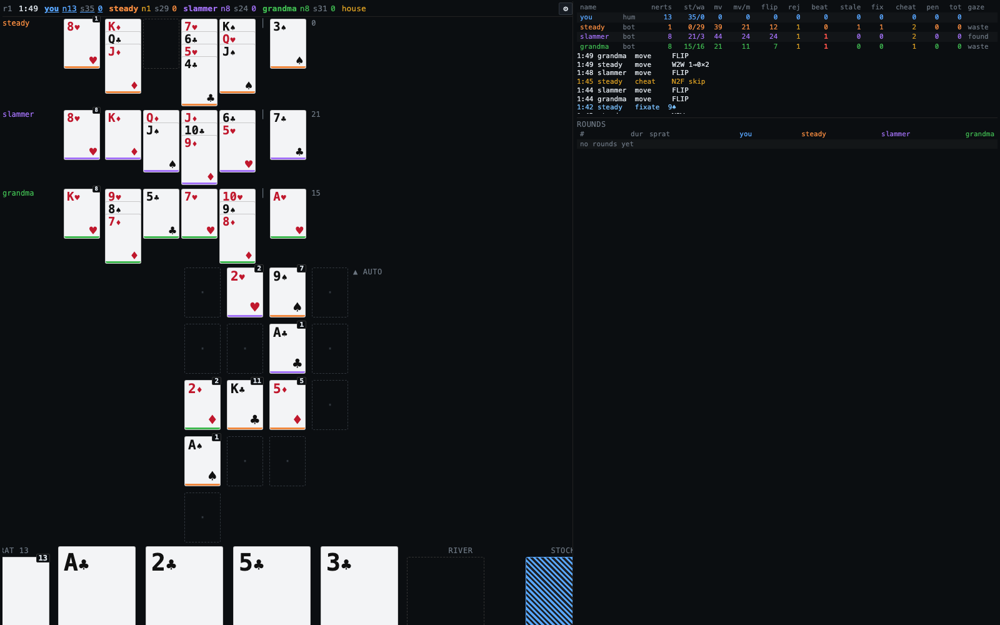
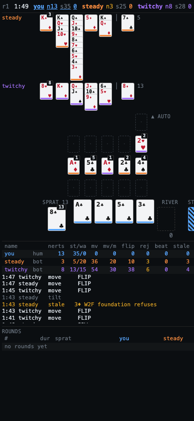
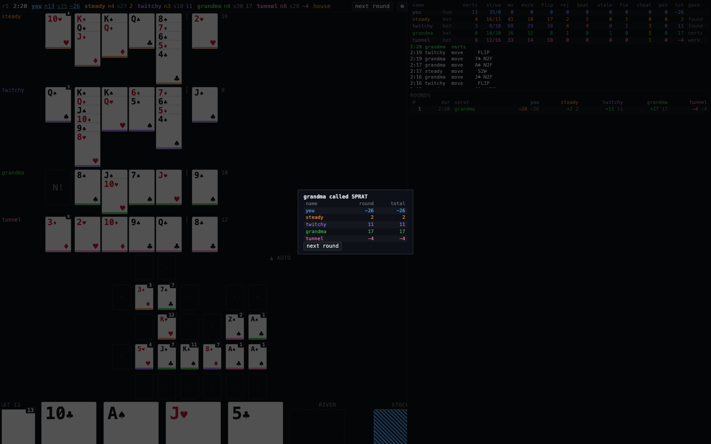

# sprat

**Sprat** is what my family calls [Nerts](https://bicyclecards.com/how-to-play/nerts) (a.k.a. Pounce / Racing Demon):
everyone plays solitaire *at the same time* onto shared foundation piles, first card there wins.
This is a web version so we can play across the country — plus bot players modelled on
how real people actually lose: they're looking at the wrong pile when the 2♥ goes down.



## Play it

```
npm install
npm run dev            # http://localhost:5178 — you vs bots, in-browser, no server needed
```

Tap a card, tap where it goes. Tap the stock to flip. `▲ auto` sends the selected card up to its foundation.
When your sprat pile is empty, hit **SPRAT!**

Phone works the same (it's just taps):



### With people

```
npm run server         # ws://0.0.0.0:8787 — put it on a LAN / Tailscale / anything
```

Each person opens `http://<host>:5178/?ws=ws://<host>:8787&room=family&name=mom`.
The first one in is host: ⚙ → add bots if you want → **deal**. Scores carry across rounds to 100.
Watch instead of play: `&spectate=1`, then click names in the header to see the table from that seat.



### House rules (`house rules` checkbox)

Grandma mode. Foundation plays may skip a rank; flips may be 2 or 4 instead of 3 (buttons under the stock).
Anyone can tap a foundation pile to inspect it and **challenge** — if it's dirty the pile unwinds and the
cheater loses 5; if it's clean the accuser loses 2. The `grandma` and `sneak` bots do this to you.

If everyone's stuck, each player rotates one stock card top→bottom and play resumes (our family rule).

## Bots

Each bot is an *attention budget*: a gaze loop over sprat pile → foundations → work piles → river,
each look costing `items / cps` seconds. It only knows what the foundations looked like the last time it
looked, so it tries plays that are already taken — the stats panel counts those as **beaten**
(someone got there first) vs **stale** (misread). That's the knob that makes it feel like a real table.

| preset | personality |
|---|---|
| `steady` | calm, watches foundations, rarely misses |
| `twitchy` | fast hands, sloppy eyes, tilts after a miss |
| `river` | lives in the stock pile |
| `builder` | works the tableau, patient |
| `grandma` | slow, kind, larcenous |
| `auditor` | inspects piles, catches cheats |
| `uncle` | colourblind |
| `slammer` | loud, messy, distracting; immune to noise |
| `sneak` | silent placements; cheats a little |
| `tunnel` | ignores the far side of the table |
| `psychic` | omniscient speed demon (the thing the rest are handicapped *away* from) |

Headless sim to tune them:

```
npm run sim -- --n 300 steady twitchy river
npm run sim -- --sweep cps=3,5,8,12 steady steady steady
```

Design notes, the attention model, cheating mechanics, calibration plan: [DESIGN.md](DESIGN.md).
Wire schema: [proto/sprat.proto](proto/sprat.proto).

## Status

Playable. Rough edges: no auth, no drag (tap-tap only), no PWA yet, bot tableau play is greedy (no lookahead).
